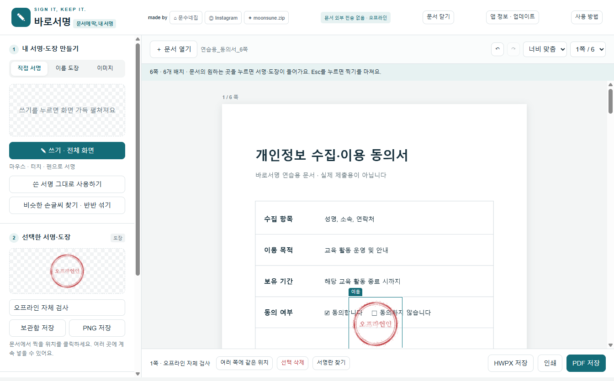
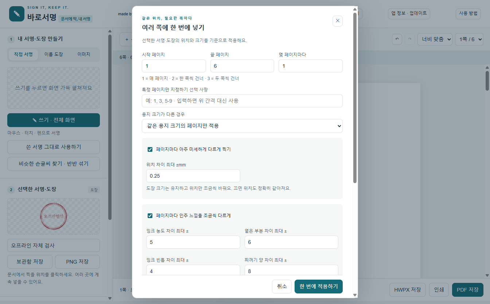

# 바로서명 · Windows 로컬 앱

문서를 열고 내 서명이나 도장을 넣어 PDF·HWPX로 저장하는 문수네집 앱입니다.

## 다운로드

**[Windows 10·11 64비트 설치 파일 다운로드](https://github.com/moonsugugu/baro-sign-download/releases/latest/download/BaroSign_Setup.exe)**

[버전별 릴리스와 SHA-256](https://github.com/moonsugugu/baro-sign-download/releases/latest)

첫 버전은 **1.0.0**입니다. 글꼴 136종과 문서 엔진을 포함해 설치 파일은 약 434MB입니다. 인터넷을 끊고 사용할 수 있습니다.

## 문서가 외부로 전송되나요?

문서·서명·입력한 이름을 서버나 AI 서비스로 보내지 않습니다. PDF·HWP·HWPX 문서 처리와 손글씨 비교·도장 생성은 PC에서 진행합니다. 문서 화면은 외부 통신을 차단하며 서버 포트를 열지 않습니다. 문서를 자동 저장하지 않습니다.

내보낸 PNG·JSON 백업·PDF/HWPX는 일반 파일이므로 저장 위치와 접근 권한을 직접 관리하세요. 서명 보관함은 Windows 사용자 계정으로 암호화합니다. 기관 보안문서의 열람·반출 허용 여부는 기관 정책을 따르며 이 앱은 별도의 보안 인증 제품이 아닙니다.

## 할 수 있는 일

- 전체 화면에서 마우스·펜·터치로 서명. 가는 펜 기본값, 시작점 잉크 뭉침 개선.
- 비슷한 무료 손글씨 101종 비교, 원래 글씨와 혼합. 이어진 획의 연결 유지.
- 이름 도장·이미지 도장, 정방향·전통 배열·좌우 반전.
- 인주 농도·옅은 곳·빈틈·찌꺼기 양과 크기 조절. 기본값은 **97 / 68 / 30 / 84 / 17**.
- 여러 쪽 같은 위치에 1·2·3쪽 또는 원하는 간격으로 적용. 크기를 유지하고 위치와 인주 무늬만 조금씩 다르게 설정.
- PDF 저장, HWP/HWPX 원문 유지 또는 페이지 그림 HWPX 저장, 인쇄, 서명 보관함·PNG·JSON 백업.

복잡한 HWP/HWPX 서식은 원본과 다르게 표시될 수 있습니다. 최종 문서를 확인하세요. PDF를 페이지 그림 HWPX로 저장하면 본문 글자는 직접 편집할 수 없습니다.

## 설치·업데이트·삭제

설치 파일을 실행하면 현재 사용자에게 설치합니다. 시작 메뉴·바탕 화면에서 실행하며 Windows 설정의 설치된 앱 또는 제어판에서 삭제할 수 있습니다. 설치 파일을 다시 실행하면 업데이트·다시 설치 또는 삭제를 선택합니다. 이전 버전으로의 덮어쓰기는 차단합니다. 앱 삭제 후에도 보관함과 따로 저장한 문서는 유지합니다.

**앱 정보 · 업데이트 → GitHub에 새 버전 확인**을 눌렀을 때만 공개 릴리스에 연결합니다. 문서·서명·파일명을 전송하지 않으며 설치 파일의 크기·SHA-256·출처를 검증합니다. 인터넷 연결 없이도 기존 서명 기능을 사용할 수 있습니다.

현재 설치 파일은 Authenticode 코드 서명이 없어 Windows가 게시자를 확인하지 못할 수 있습니다. 공식 저장소와 SHA-256을 확인하세요.

## 화면

made by [문수네집](https://moonsunezip.com) · [Instagram](https://www.instagram.com/moonsune.zip/) · [moonsune.zip](https://moonsunezip.com)
